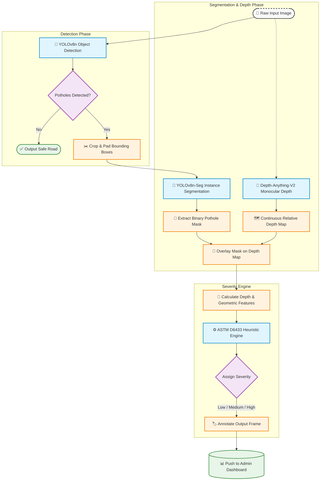

# AI-Powered Road Damage Detection & Municipal Management System

## Overview
This repository contains the Machine Learning vision pipeline for a real-time municipal dashboard system designed to autonomously detect, localize, and assess the severity of road damage (potholes).

While many object detection projects stop at drawing bounding boxes, true municipal triage requires geometric understanding. This pipeline uniquely integrates:
1. **Instance Segmentation (YOLOv8n-Seg):** To extract pixel-perfect damage area geometries.
2. **Monocular Depth Estimation (Depth-Anything-V2):** To approximate pothole depth without stereo cameras or LiDAR.
3. **ASTM D6433 Heuristics Engine:** To cross-reference segmented area and depth maps against established civil engineering standards, assigning functional `LOW`, `MEDIUM`, or `HIGH` severity ratings.

## Quick Links
- **[Documentation Suite](docs/01_overview.md)**: Comprehensive architectural breakdown.
- **[Model Card](docs/MODEL_CARD.md)**: Evaluation metrics, dataset details, and known failure modes.
- **[Open Items](OPEN_ITEMS.md)**: Current limitations and research directions.

## Pipeline Architecture

## Setup & Inference
See [docs/09_reproducing.md](docs/09_reproducing.md) for full environment setup and execution instructions.
