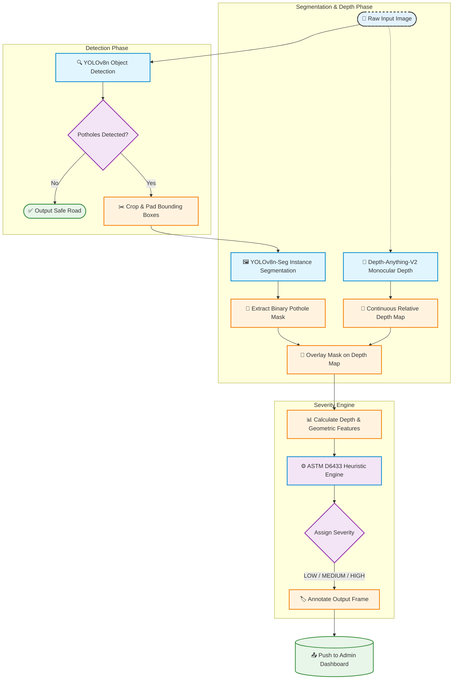

# AI-Powered Road Damage Detection & Municipal Management System

[](https://opensource.org/licenses/MIT)
[](https://www.python.org/downloads/)
[](https://pytorch.org/)

## 📋 Table of Contents

- [🔍 The Problem](#-the-problem)
- [💡 Our Solution](#-our-solution)
- [🏗️ Architecture Workflow](#️-architecture-workflow)
- [📊 Results & Metrics](#-results--metrics)
- [🔧 Setup & Reproduce](#-setup--reproduce)
- [📁 Project Structure](#-project-structure)
- [🤝 Contributing](#-contributing)
- [📄 License](#-license)

---

## 🔍 The Problem

Road departments worldwide face an escalating challenge: **maintaining safe road infrastructure** across vast geographic areas with limited resources. The core problems are:

| Problem | Impact |
|---------|--------|
| **Manual inspection is expensive** | Requires field crews, vehicles, and significant labor hours across large road networks |
| **Manual severity assessment is subjective** | Different inspectors assign different severity levels to the same damage, leading to inconsistent prioritization |
| **Citizen reporting (311) lacks quantitative data** | Reports are unverified, often duplicated, and carry no severity metrics for triage |
| **No fast, scalable triage system** | Damaged roads remain unrepaired longer, increasing risk to motorists and citizens |
| **Lack of accessible 3D road damage data** | LiDAR/stereo cameras are expensive; dashcams lack depth perception, making it hard to estimate pothole depth |

The result: dangerous road conditions go unreported, repair budgets are misallocated, and municipal agencies cannot scale their inspection operations efficiently.


## 🏗️ Architecture Workflow


### Pipeline Stages Explained


## 📊 Results & Metrics

### Dataset

| Metric | Value |
|---------|-------|
| **Total Images** | 1,986 (1,336 annotated + 650 background) |
| **Sources Merged** | andrewmvd, v2-2022, RDD2022, PothRGBD |
| **Split** | 70% Train / 15% Val / 15% Held-out Test |
| **Dedup** | Perceptual-hash based (removed ~38% duplicates) |

### Detection (Phase 1 v2 — Final Model on v1 Test Set)

| Metric | Value |
|--------|-------|
| **Precision** | 0.9262 |
| **Recall** | 0.8578 |
| **mAP@50** | 0.9537 |
| **mAP@50:95** | 0.7044 |

### Detection — 5-Fold Cross-Validation (Mean ± Std)

| Fold | Precision | Recall | mAP@50 | mAP@50:95 |
|------|-----------|--------|--------|-----------|
| 0 | 0.7339 | 0.6676 | 0.7421 | 0.4429 |
| 1 | 0.7596 | 0.6560 | 0.7273 | 0.4379 |
| 2 | 0.7802 | 0.6622 | 0.7365 | 0.4370 |
| 3 | 0.8201 | 0.5993 | 0.7142 | 0.4245 |
| 4 | 0.8111 | 0.6254 | 0.7362 | 0.4199 |
| **Mean±Std** | **0.7810±0.0319** | **0.6421±0.0259** | **0.7313±0.0098** | **0.4324±0.0087** |

### Segmentation (Phase 2 — YOLOv8n-Seg on PothRGBD)

| Metric | Box | Mask |
|--------|-----|------|
| **Precision** | 0.901 | 0.919 |
| **Recall** | 0.866 | 0.884 |
| **mAP@50** | 0.907 | 0.908 |
| **mAP@50:95** | 0.589 | 0.592 |

### Depth Estimation (Depth-Anything-V2)

| Metric | Value |
|--------|-------|
| **Mean Pearson Correlation** | ~73% (after sign convention correction) |
| **Frames with weak/wrong-sign depth** | 22% |
| **Status** | Diagnostic-only; not fed into severity decision |

### Severity Distribution (Demo Run — 6 Images)

| Domain | Severity | Count |
|--------|----------|-------|
| Phase 1 (open road) | LOW | 1 |
| Phase 1 (open road) | MEDIUM | 7 |


## 🔧 Setup & Reproduce

### Prerequisites

- **Python**: 3.10 or higher
- **GPU**: NVIDIA GPU with CUDA 11.8+ (strongly recommended for training; inference can run on CPU)
- **Disk Space**: ~10 GB for datasets, checkpoints, and training runs
- **Kaggle API**: Kaggle credentials (`~/.kaggle/kaggle.json`) for downloading external datasets

### Step 1: Clone the Repository

```bash
git clone https://github.com/mohanreddythippireddy14-cell/Pothole_detection.git
cd Pothole_detection
```

### Step 2: Create and Activate a Virtual Environment

```bash
# Windows
python -m venv .venv
.venv\Scripts\activate

# macOS / Linux
python3 -m venv .venv
source .venv/bin/activate
```

### Step 3: Install Dependencies

```bash
pip install --upgrade pip
pip install -r requirements.txt
```

### Step 4: Download Datasets

```bash
# Download PothRGBD (segmentation dataset)
python scripts/06_download_pothrgbd.py

# Download other datasets (andrewmvd, RDD2022, etc.)
# Uses kagglehub via scripts/01_download_and_audit.py
python scripts/01_download_and_audit.py
```

### Step 5: Train the Detection Model

```bash
# Phase 1: Train YOLOv8n detector
python scripts/03_train_yolov8n.py

# Phase 1 v2: Train on merged mega-dataset (5-fold CV + final)
python scripts/12_kfold_train.py
python scripts/13_train_final_v2.py
```

### Step 6: Train the Segmentation Model

```bash
# Train YOLOv8n-Seg on PothRGBD
python scripts/07_build_pothrgbd_yolo_seg.py
python scripts/08_train_yolov8n_seg.py
```


## 🤝 Contributing

We welcome contributions! Please see [CONTRIBUTING.md](CONTRIBUTING.md) for guidelines.

**Current priority areas:**
1. Handling standing water (tricks the depth estimator)
2. Implementing PII blurring (faces/license plates) in pre-processing
3. Edge deployment optimizations (TensorRT/ONNX exports)

**Pull Request Protocol:**
1. Fork the repository
2. Ensure code separates ML pipeline logic from dashboard routing logic
3. Test against the holdout test set to verify mAP has not degraded
4. Submit a PR with a clear summary and before/after metrics

---

## 📄 License

This project is licensed under the MIT License — see the [LICENSE](LICENSE) file for details.

---

## 🙏 Acknowledgments

- **andrewmvd** — Pothole detection dataset
- **v2-2022** — Pothole dataset
- **RDD2022** — Road damage dataset
- **PothRGBD** — RGB-D pothole dataset with segmentation masks
- **Depth-Anything-V2** — Monocular depth estimation
- **Ultralytics** — YOLOv8 implementation

### Step 7: Run the Full Pipeline (Inference)

```bash
# Quick inference without depth estimation (CPU-friendly)
python scripts/10_full_pipeline.py --images docs/assets/samples/potholes103_raw.png --out-dir outputs/

# Full pipeline with depth estimation (requires CUDA)
python scripts/10_full_pipeline.py --images docs/assets/samples/potholes103_raw.png --out-dir outputs/
# (remove --no-depth flag from above to enable depth branch)
```

### Step 8: Evaluate the Model

```bash
# Evaluate detection model on held-out test set
python scripts/04_evaluate.py

# Evaluate depth estimation accuracy
python scripts/09_evaluate_depth_anything.py

# Visualize sample predictions
python scripts/05_visualize_samples.py
```

### Step 9: (Optional) Download Pre-trained Weights

Already included in the repo as `checkpoints/*.pt` via the initial commit. For fresh runs, download from:

- [YOLOv8n detector v2 final](checkpoints/yolov8n_pothole_v2_final_best.pt)
- [YOLOv8n-Seg PothRGBD](checkpoints/yolov8n_seg_pothrgbd_best.pt)
- [Depth-Anything-V2](https://github.com/facebookresearch/depth-anything)

---

## 📁 Project Structure

```
Pothole_detection/
├── LICENSE
├── README.md
├── requirements.txt
├── .gitignore
├── CHECK.md
├── OPEN_ITEMS.md
├── PROJECT.md
├── CONTRIBUTING.md
├── CHANGELOG.md
├── docs/
│   ├── 01_overview.md
│   ├── 02_dataset_and_split.md
│   ├── 03_phase1_baseline.md
│   ├── 04_phase2_segmentation.md
│   ├── 05_phase3_severity.md
│   ├── 06_results.md
│   ├── 07_failure_modes.md
│   ├── 08_deployment_and_dashboard.md
│   ├── 09_reproducing.md
│   ├── 10_project_history.md
│   └── MODEL_CARD.md
├── src/
│   ├── config.py
│   └── _py311_compat.py
├── scripts/
│   ├── 01_download_and_audit.py
│   ├── 02_convert_voc_to_yolo.py
│   ├── 03_train_yolov8n.py
│   ├── 04_evaluate.py
│   ├── 05_visualize_samples.py
│   ├── 06_download_pothrgbd.py
│   ├── 07_build_pothrgbd_yolo_seg.py
│   ├── 08_train_yolov8n_seg.py
│   ├── 09_evaluate_depth_anything.py
│   ├── 10_full_pipeline.py
│   ├── 11_build_combined_kfold_dataset.py
│   ├── 12_kfold_train.py
│   ├── 13_train_final_v2.py
│   └── 14_calibrate_severity.py
├── data/
│   ├── datasets/
│   ├── cache/
│   └── kagglehub/
├── context/                 # Evaluation logs, plots, results
├── checkpoints/             # Trained model weights
├── runs/                    # Ultralytics training runs
└── notebooks/               # Jupyter notebooks
```

| Phase 1 (open road) | HIGH | 3 |
| Phase 1 (open road) | UNKNOWN | 1 |
| PothRGBD (close-up) | MEDIUM | 1 |
| PothRGBD (close-up) | HIGH | 4 |
| PothRGBD (close-up) | UNKNOWN | 1 |

### Key Findings

- **Recall is the critical improvement**: v2 improved Recall from 0.6770 (v1) to 0.8578 on the same benchmark (+19pp), directly addressing the initial low-recall problem (missed 24-32% of potholes).
- **mAP@50:95 improved by +23pp**: The metric most relevant for severity scoring improved from 0.4773 to 0.7044.
- **Background false-positive rate measured**: 2.3% (3/130) on held-out background images — first time this was quantified.
- **Cross-domain generalization gap**: The segmentation model trained on PothRGBD's single-capture-date domain struggles on open-road scenes; this is a known limitation and an active research direction.

### Comparison: v1 vs v2

| Metric | v1 (original) | v2 (merged mega-dataset, FINAL) |
|--------|---------------|--------------------------------|
| Precision | 0.7935 | **0.9262** |
| Recall | 0.6770 | **0.8578** |
| mAP@50 | 0.7708 | **0.9537** |
| mAP@50:95 | 0.4773 | **0.7044** |

| Stage | Component | Input | Output |
|-------|-----------|-------|--------|
| **1. Detection** | YOLOv8n (object detection) | Raw RGB image | Bounding boxes + confidence |
| **2. Segmentation** | YOLOv8n-Seg | Padded crop around detection | Pixel-perfect binary mask |
| **3. Depth Estimation** | Depth-Anything-V2 | Raw RGB image | Continuous relative depth map |
| **4. Feature Extraction** | Geometric analysis | Mask + depth map | Area, depth_p95, width, height, aspect_ratio |
| **5. Severity Scoring** | ASTM D6433 heuristics | Area + depth features | `LOW`, `MEDIUM`, or `HIGH` label |
| **6. Dashboard** | JSON payload | Severity + detections | Push to SIH Municipal Dashboard |


---

## 💡 How Our Solution Solves This

We present an **end-to-end AI vision pipeline** that transforms a raw RGB image (from dashcam, traffic camera, or citizen upload) into **actionable, structured triage data** automatically.

### Core Capabilities

1. **Object Detection (YOLOv8n)** — Detects potholes in road scenes with bounding boxes and confidence scores.
2. **Instance Segmentation (YOLOv8n-Seg)** — Extracts pixel-perfect pothole masks for accurate geometric measurement.
3. **Monocular Depth Estimation (Depth-Anything-V2)** — Approximates pothole depth from a single RGB image (no LiDAR/stereo needed) by projecting 2D pixels into pseudo-3D space.
4. **ASTM D6433 Heuristic Engine** — Applies civil engineering standards to assign `LOW`, `MEDIUM`, or `HIGH` severity ratings based on surface area and depth features.
5. **Municipal Dashboard Integration** — Outputs structured JSON payloads (pothole count, coordinates, severity, confidence) that plug directly into a GIS-backed dashboard for geographic aggregation and routing.

### Key Innovations

- **Fused 2D + Pseudo-3D pipeline**: Combines instance segmentation with monocular depth to satisfy ASTM D6433 without expensive hardware.
- **Domain-merged dataset**: Aggregated 4 public datasets (andrewmvd, v2-2022, RDD2022, PothRGBD) into 1,986 curated images with strict 70/15/15 train/val/test splits and no leakage.
- **5-fold cross-validation**: Provides robust performance estimates across folds instead of a single fixed-split number.
