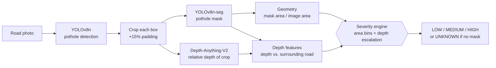

# Pothole Detection & Severity Estimation

[](https://github.com/mohanreddythippireddy14-cell/Pothole_detection/actions/workflows/tests.yml)
[](LICENSE)
[](https://www.python.org/downloads/)
[](https://docs.ultralytics.com/)

From a single road photo to a **LOW / MEDIUM / HIGH severity rating for every pothole**,
with no LiDAR, stereo camera or camera calibration.

The pipeline chains three models (YOLOv8n detection → YOLOv8n-seg segmentation →
Depth-Anything-V2 monocular depth) and then hands their outputs to a **rule-based severity
engine** modelled on the pavement-engineering standard **ASTM D6433**.

<p align="center">
  
  <br><sub>Example output (box colour = severity). This photo is from the training data, so it
  only illustrates the output format.</sub>
</p>

---

## Table of contents
1. [Why this project](#why-this-project)
2. [How it works](#how-it-works)
3. [⭐ The severity engine](#-the-severity-engine)
4. [Results](#results)
5. [Data](#data)
6. [Setup and usage](#setup-and-usage)
7. [Project structure](#project-structure)
8. [Limitations and future work](#limitations-and-future-work)
9. [License and acknowledgments](#license-and-acknowledgments)

---

## Why this project

Road departments decide which potholes to repair first, but:

- **Manual inspection is slow and subjective.** Different inspectors rate the same damage differently.
- **Citizen reports carry no severity information.** A photo says "there is a pothole", not "how bad".
- **Depth matters but is expensive to measure.** ASTM D6433 rates potholes by *diameter × depth*,
  and depth normally needs LiDAR or stereo cameras.

This project estimates severity from an ordinary RGB photo, using monocular depth estimation
as a stand-in for depth sensors.

## How it works



| Stage | Model / method | Output |
|---|---|---|
| 1. Detection | YOLOv8n fine-tuned on 1,986 merged images | Pothole boxes + confidence |
| 2. Segmentation | YOLOv8n-seg fine-tuned on PothRGBD, run on each padded crop | Pothole pixel mask |
| 3. Depth | Depth-Anything-V2-Small (pretrained, no fine-tuning), run on each crop | Relative (unitless) depth map |
| 4. Features | Mask area relative to the whole image; 95th-percentile depth inside the mask vs. the road ring around it | `relative_area`, `steepness` |
| 5. Severity | Rule-based engine (below) | `LOW` / `MEDIUM` / `HIGH` / `UNKNOWN` |

All of this lives in [`scripts/10_full_pipeline.py`](scripts/10_full_pipeline.py).

## ⭐ The severity engine

There is **no ground-truth severity** for an arbitrary road photo, so severity is not learned
by a model. Instead, it comes from **transparent decision rules** that copy the structure of
ASTM D6433, where severity depends on both size and depth and *a deeper pothole of the same
size is rated more severe*:

| ASTM D6433 (Table X1.1) | Depth 13–25 mm | 25–50 mm | > 50 mm |
|---|---|---|---|
| Diameter 100–200 mm | Low | Low | Medium |
| 200–450 mm | Low | Medium | High |
| 450–750 mm | Low | Medium | High |

Without camera calibration there are no millimetres, so each factor uses a scale-free proxy:

```text
area_score = LOW     if relative_area < 0.0208
             MEDIUM  if relative_area < 0.1030
             HIGH    otherwise

if steepness > 0.00381:                       # unusually deep for its size
    area_score = min(area_score + 1, HIGH)    # depth can raise severity, never lower it

no segmentation mask found  ->  UNKNOWN       # "couldn't measure" is not the same as LOW
```

- **Size factor (`relative_area`):** pothole mask pixels ÷ image pixels. The two thresholds were
  grid-searched for balanced accuracy against the 1,886 minor/medium/major-labelled boxes in
  [idanbaru/annotated-potholes-with-severity-levels](https://www.kaggle.com/datasets/idanbaru/annotated-potholes-with-severity-levels)
  (balanced accuracy 52.5% vs. 33% chance). Area alone is clearly not enough, which is why depth is a second factor.
- **Depth factor (`steepness`):** how far the pothole interior sits below the surrounding road
  (95th percentile, on Depth-Anything-V2's relative scale) divided by the pothole's pixel extent.
  It works like a depth-to-diameter ratio. The escalation threshold is the 90th percentile of this
  ratio over 59 PothRGBD pothole photos.
- **Calibration** is reproducible with [`scripts/14_calibrate_severity.py`](scripts/14_calibrate_severity.py)
  and stored in [`context/severity_calibration.json`](context/severity_calibration.json).
  Full design notes: [`context/SEVERITY_FUNCTION.md`](context/SEVERITY_FUNCTION.md).

Example: a small but visibly deep pothole (`potholes642.png`, relative area 0.0095 → LOW by
size alone) is escalated to **MEDIUM** by the depth factor, the same logic ASTM applies.

> The engine is an *approximation* of expert judgement, not a validated measurement. Its known
> gaps are listed in [Limitations](#limitations-and-future-work).

## Results

### Detection (YOLOv8n)

| Evaluation | Precision | Recall | mAP@50 | mAP@50:95 |
|---|---|---|---|---|
| **v2, 5-fold cross-validation (mean ± std)** | **0.781 ± 0.032** | **0.642 ± 0.026** | **0.731 ± 0.010** | **0.432 ± 0.009** |
| v2 final model, its own 10% validation split (epoch 60) | 0.789 | 0.632 | 0.731 | 0.418 |
| v1 baseline (665 images, held-out 67-image test set) | 0.794 | 0.677 | 0.771 | 0.477 |
| ~~v2 final model on the v1 test set~~ | ~~0.926~~ | ~~0.858~~ | ~~0.954~~ | ~~0.704~~ |

> ⚠️ **The struck-out 0.95 mAP@50 is not valid.** The v1 test photos also appear in the v2
> training data (the chitholian dataset contains the same 665 photos as andrewmvd at higher
> resolution), so that number measures images the model had already seen. The **5-fold
> result, mAP@50 ≈ 0.73, is the reliable figure** until a clean re-evaluation on an untouched
> test set is done (planned in [`FUTURE_ACTIONS.md`](FUTURE_ACTIONS.md)).
>
> The v2 validation folds are harder than v1's test set (650 pothole-free images that
> penalise false positives, plus more varied close-ups), so v1 and v2 numbers are not
> directly comparable.

Background false positives: 3 of 130 pothole-free validation images (2.3%) produced a detection.

### Segmentation (YOLOv8n-seg on PothRGBD, 100-image test split)

| | Precision | Recall | mAP@50 | mAP@50:95 |
|---|---|---|---|---|
| Box | 0.901 | 0.866 | 0.907 | 0.589 |
| Mask | 0.919 | 0.884 | 0.908 | 0.592 |

> **In-domain result.** PothRGBD's ~1,000 frames come from only two recording sessions and were
> split randomly, so test frames have near-identical neighbours in training. Expect lower mask
> quality on other road photos. In the demo runs, the segmenter sometimes finds no mask on
> open-road crops, which the engine reports as `UNKNOWN`.

### Depth (Depth-Anything-V2-Small vs. PothRGBD sensor depth, 40 images)

Pearson correlation **r = −0.73** on average (sign is negative because the model outputs
*inverse* depth: near = high). 95% of images show the expected negative correlation; 17% are
weak (|r| < 0.3). Depth is therefore usable as a *relative* signal, not a metric measurement.

## Data

| Source | Used for | Images used | Notes |
|---|---|---|---|
| [chitholian/annotated-potholes-dataset](https://www.kaggle.com/datasets/chitholian/annotated-potholes-dataset) | Detection | 665 | The same photos as andrewmvd, at 720×720 instead of ~400×300; replaces andrewmvd in v2 |
| [rajdalsaniya/pothole-detection-dataset](https://www.kaggle.com/datasets/rajdalsaniya/pothole-detection-dataset) | Detection | 671 | 2,083 Roboflow-augmented files collapsed to one image per original photo |
| [banilkumar…/pothole-and-normal-road-pavement-augmented-data](https://www.kaggle.com/datasets/banilkumar20phd7071/pothole-and-normal-road-pavement-augmented-data) | Detection (background) | 650 | "Normal" road images with empty labels, to measure false positives |
| [andrewmvd/pothole-detection](https://www.kaggle.com/datasets/andrewmvd/pothole-detection) | Detection v1 baseline | 665 | v1 only (80/10/10 split) |
| [mahyeks/pothrgbd](https://www.kaggle.com/datasets/mahyeks/pothrgbd-rgb-and-depth-images-of-potholes) | Segmentation, depth evaluation, depth calibration | 1,000 | RGB + sensor depth + polygon masks |
| [idanbaru/annotated-potholes-with-severity-levels](https://www.kaggle.com/datasets/idanbaru/annotated-potholes-with-severity-levels) | Severity area calibration | 1,886 boxes | minor / medium / major labels |

**Detection v2 dataset: 1,986 images** (1,336 annotated + 650 background), built by
[`scripts/11`](scripts/11_build_combined_kfold_dataset.py). Evaluated with **5-fold
cross-validation** ([`scripts/12`](scripts/12_kfold_train.py)). The final model is trained on a
90/10 split ([`scripts/13`](scripts/13_train_final_v2.py)). There is currently **no separate
held-out test set** for v2.

## Setup and usage

### 1. Install

```bash
git clone https://github.com/mohanreddythippireddy14-cell/Pothole_detection.git
cd Pothole_detection
python -m venv .venv
source .venv/bin/activate          # Windows: .venv\Scripts\activate
pip install -r requirements.txt
```

Large data (datasets, Kaggle cache) goes under `data/` by default. Point it elsewhere with
`POTHOLE_DATA_ROOT=/path/to/disk`. Downloading the Kaggle datasets requires
[Kaggle API credentials](https://github.com/Kaggle/kagglehub#authenticate).

### 2. Get the trained weights

Place these files in `checkpoints/`:

- `yolov8n_pothole_v2_final_best.pt` (detector)
- `yolov8n_seg_pothrgbd_best.pt` (segmenter)

They will be published on the [Releases page](https://github.com/mohanreddythippireddy14-cell/Pothole_detection/releases).
Until then, train them with steps 3–4 below. Depth-Anything-V2 downloads automatically from Hugging Face.

### 3. Run the pipeline on your own photos

```bash
# Full pipeline, including depth (runs on CPU; a GPU makes it faster)
python scripts/10_full_pipeline.py --images path/to/photo1.jpg path/to/photo2.jpg --out-dir outputs/

# Faster: size-based severity only, skip the depth model
python scripts/10_full_pipeline.py --images path/to/photo.jpg --out-dir outputs/ --no-depth
```

For each image this writes `outputs/<name>_annotated.png` (boxes coloured by severity) and
appends to `outputs/REPORT.md` (per-pothole severity, confidence, area and depth features).

### 4. Reproduce training (GPU recommended)

| Step | Script | What it does |
|---|---|---|
| v1 detector | `01` → `02` → `03` → `04 --weights checkpoints/yolov8n_pothole_best.pt` | Download/audit andrewmvd, convert VOC→YOLO, train, evaluate on test split |
| Segmenter | `06` → `07` → `08` | Download/audit PothRGBD, build YOLO-seg dataset, train |
| Depth check | `09` | Compare Depth-Anything-V2 with PothRGBD sensor depth |
| v2 detector | `11` → `12` → `13` | Merge datasets, 5-fold CV, train final model |
| Severity | `14` | Calibrate area thresholds and depth escalation |
| Samples | `05 [--weights …]` | Plot training samples and test predictions |

### 5. Run the tests

```bash
pip install -r requirements-dev.txt
pytest
```

The unit tests cover annotation conversion, dataset-merge helpers, the severity rules and mask
geometry. They need no GPU, weights or datasets and run on every push via GitHub Actions.

## Project structure

```
Pothole_detection/
├── scripts/                01–14: data prep, training, evaluation, pipeline, calibration
├── src/
│   ├── config.py           paths (POTHOLE_DATA_ROOT), ensure_dirs()
│   ├── fs_utils.py         symlink-or-copy helper for dataset folders
│   └── _py311_compat.py    shim for broken pre-release Python 3.11 builds (no-op otherwise)
├── tests/                  unit tests (pytest)
├── context/                results, audits, design notes, calibration JSON, plots
├── docs/                   overview chapters, model card, sample outputs
│   └── archive/            historical working notes (not maintained)
├── runs/                   training logs (results.csv + args.yaml per run)
├── FUTURE_ACTIONS.md       planned work and current limitations
├── requirements.txt        runtime dependencies
├── requirements-dev.txt    + pytest, black, flake8
└── CITATION.cff, LICENSE
```

## Limitations and future work

- **Detection needs a clean re-evaluation.** There is no untouched v2 test set yet; the 5-fold score is the best current estimate.
- **Severity calibration is approximate.** The area thresholds were fitted on *bounding-box* area
  (all idanbaru provides) but are applied to *mask* area, which is smaller, so ratings lean low.
  The 52.5% accuracy is measured on the same boxes used for fitting. The idanbaru labels are
  partly script-generated and share photos with the detection data.
- **Depth is relative and uncalibrated.** Depth-Anything-V2 outputs inverse relative depth; the
  depth factor treats its negation as depth, which is a rough approximation. The escalation threshold
  comes from full PothRGBD images with true masks, while the pipeline applies it to crops with predicted masks.
- **Segmentation is in-domain** (two recording sessions) and can miss potholes in open-road crops.
- **No end-to-end severity accuracy** has been measured for the full pipeline yet.
- **Planned, not built:** JSON output for a municipal dashboard, video/real-time processing,
  number-plate and face blurring, edge deployment.

Every item, with concrete steps, is tracked in [`FUTURE_ACTIONS.md`](FUTURE_ACTIONS.md).

## License and acknowledgments

Code is released under the [MIT License](LICENSE). Datasets keep their own licenses. See each
Kaggle page above.

Built with [Ultralytics YOLOv8](https://github.com/ultralytics/ultralytics),
[Depth-Anything-V2](https://github.com/DepthAnything/Depth-Anything-V2) and
[Hugging Face Transformers](https://github.com/huggingface/transformers). Thanks to the
authors of all the datasets listed in [Data](#data).
