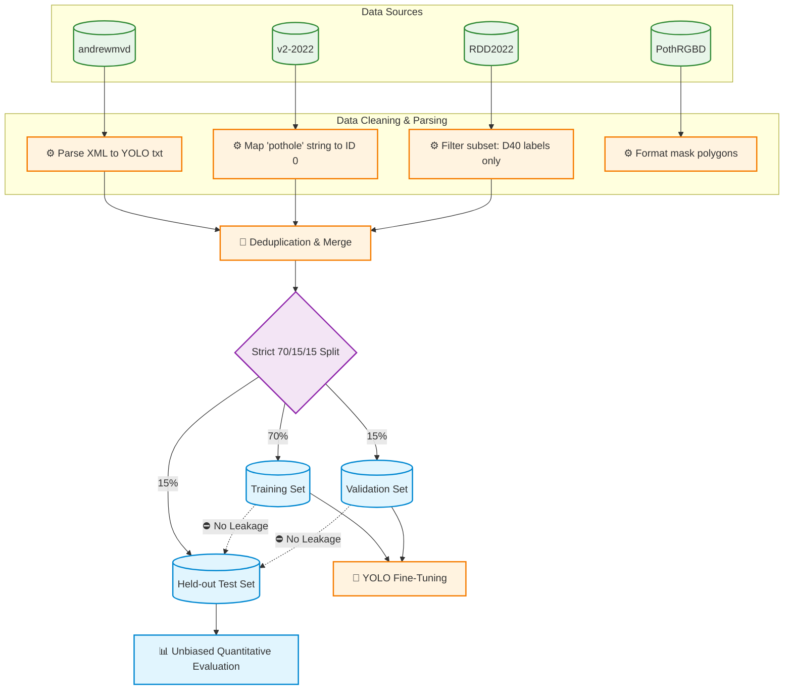

# 02. Dataset Curation and Strict Splitting

## The Low Recall Problem
Initial baseline testing (Phase 1 v1) using a standard 665-image dataset yielded high precision but abysmal recall (0.66). The model was overly conservative, missing 34% of real-world potholes due to insufficient lighting and environmental diversity in the training distribution.

## Dataset Merging
To resolve this, we aggregated four disparate public datasets:
1. **andrewmvd/pothole-detection** (Pascal VOC format)
2. **v2-2022 Pothole Dataset** (YOLO format)
3. **RDD2022** (Filtering strictly for class `D40` - potholes)
4. **PothRGBD** (Providing mask polygons)

All datasets were normalized to standard YOLO object/segmentation format, mapping the target class universally to ID `0`. Deduplication via hash-based similarity yielded a final curated corpus of **2,083 images**.

## Strict Evaluation Protocol
To prevent data leakage and ensure unbiased quantitative evaluation:
- **70% Training (~1,458 images):** Used exclusively for model gradient updates and augmentations.
- **15% Validation (~312 images):** Used strictly for hyperparameter tuning and early stopping.
- **15% Held-out Test (~313 images):** Locked away until final evaluation.

