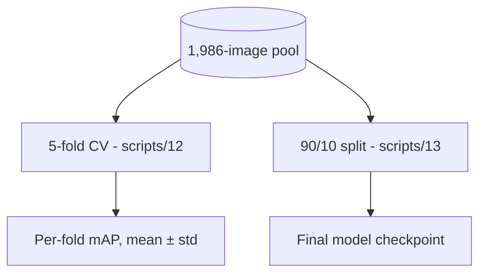

# 02. Dataset Curation and Splitting

## v1 baseline
`andrewmvd/pothole-detection`: 665 images (~400×300), VOC boxes, converted to YOLO and split 80/10/10 (532 / 66 / 67, seed 42) by `scripts/02`. One zero-width box was dropped. Recall was the weak point (0.68 on the test split).

## v2 merged detection dataset (`scripts/11`)
| Source | Kept | How it was merged |
|---|---|---|
| chitholian | 665 | Same photos as andrewmvd, at 720×720. Matched 665/665 with a 16×16 grayscale similarity check and **replaces** andrewmvd. |
| rajdalsaniya | 671 | 2,083 Roboflow-augmented files grouped by original photo; one image kept per group to avoid near-duplicates across folds. A 60-image sample showed no overlap with chitholian. |
| banilkumar "Normal" | 650 | Pothole-free road images with empty labels (background), so false positives are measured. Its "Pothole" folder has no boxes and is excluded. |

**Total: 1,986 images** (1,336 annotated + 650 background).

## Evaluation protocol (as implemented)

- **5-fold cross-validation** gives the reported score (mAP@50 0.731 ± 0.010). The same fold is used for best-checkpoint selection and scoring, so it is slightly optimistic.
- The **final model** trains on 90% of the pool, with 10% for validation and early stopping.
- **There is no untouched test set for v2.** Evaluating v2 on the v1 test split is invalid, because those photos (as chitholian copies) are in the v2 pool.

## Known risks
- banilkumar is an *augmented* dataset; augmented copies of the same background photo may sit in different folds.
- See `FUTURE_ACTIONS.md` for the planned group-aware held-out test split.
