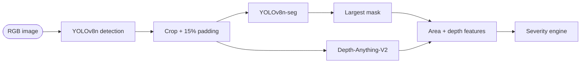

# 04. Phase 2: Instance Segmentation

## Approach
YOLOv8n-seg (COCO-pretrained) is fine-tuned on PothRGBD's polygon masks (`scripts/07`, `scripts/08`). At inference (`scripts/10`), each detected box is padded by 15%, cropped, and segmented. The largest mask in the crop is kept, using `retina_masks=True` so the mask matches the crop's resolution.

## Results (PothRGBD 100-image test split)
| | Precision | Recall | mAP@50 | mAP@50:95 |
|---|---|---|---|---|
| Box | 0.901 | 0.866 | 0.907 | 0.589 |
| Mask | 0.919 | 0.884 | 0.908 | 0.592 |

**These are in-domain numbers.** PothRGBD's ~1,000 frames come from two recording sessions and were split randomly, so test frames have near-identical neighbours in training. In demo runs on open-road photos, the segmenter sometimes finds no mask; the pipeline then reports `UNKNOWN` instead of guessing.

