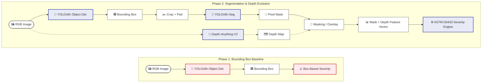

# 04. Phase 2: Instance Segmentation

## Architectural Shift
To solve the geometric distortion identified in Phase 1, the pipeline was upgraded to utilize `YOLOv8n-Seg`. Instead of relying on a crude rectangular boundary, the model now predicts a pixel-perfect polygon mask for each detected instance.

## Implementation Details
Due to the computational overhead of high-resolution instance segmentation on wide field-of-view images, the pipeline employs a two-stage approach:
1. **Detection:** A rapid YOLOv8n pass identifies the general bounding region.
2. **Crop & Segment:** The bounding box is cropped (with padding), and only that specific tensor is passed to YOLOv8n-Seg for precise mask extraction.

## Results
The segmentation model achieved a **Mask mAP@50 of 0.908**. This pixel-level accuracy allowed for the exact calculation of the pothole's 2D surface area relative to the frame, forming the foundation of the geometric feature vector.

