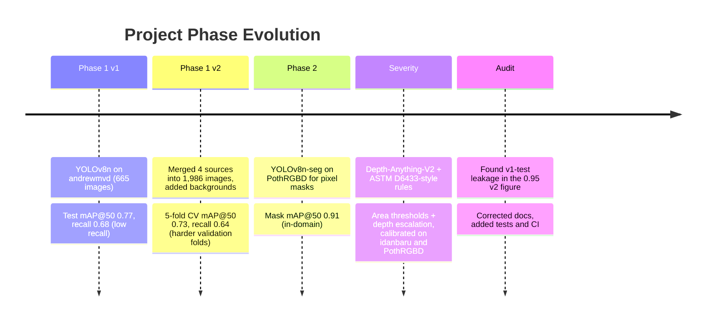

# 10. Project History & Evolution

Earlier documentation reported a v2 mAP@50 of 0.95. That figure was measured on photos that were also in the training data, and has been withdrawn. Historical notes are in `archive/`.
