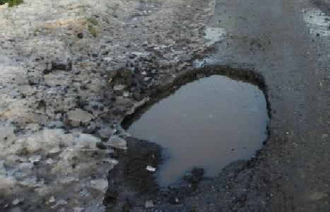
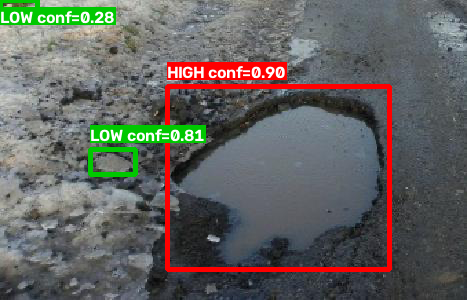

# Inference Example

Raw photo vs. pipeline output (box colour = severity). This run used `--no-depth`, so severity comes from size only. The photo is from the training data and only illustrates the output format.

| Raw Input (`potholes103_raw.png`) | Pipeline Output (`potholes103_annotated.png`) |
|---|---|
|  |  |

## Pipeline Log
```text
- pothole 0: severity=HIGH, det_conf=0.904, relative_area=0.2095, box_px=210x188
- pothole 1: severity=LOW, det_conf=0.809, relative_area=0.0117, box_px=57x30
- pothole 2: severity=LOW, det_conf=0.281, relative_area=0.0062, box_px=43x21
```
